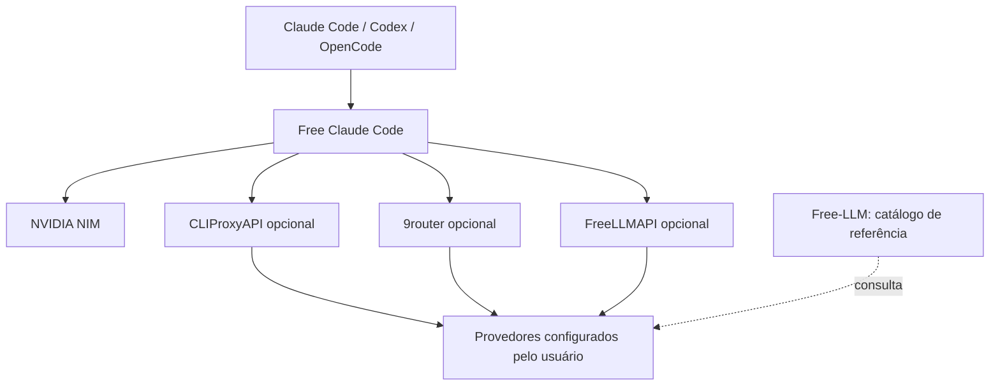

# Arquitetura

O FCC permanece nativo no host para trabalhar com os agentes e suas configurações. Os gateways são contêineres opcionais acessados pelo host. Eles não dependem uns dos outros e não recebem a chave NVIDIA automaticamente.

`super-fcc.py` roda com biblioteca padrão do Python. `scripts/fcc_config.py` roda no ambiente do FCC fixado, usa `ManagedConfigStore`, valida a configuração, faz backup e salva com detecção de alterações concorrentes. O helper só aceita as duas operações internas: perfil NVIDIA e conexão de gateway. A chave viaja por stdin, não por argumentos visíveis na lista de processos.

O catálogo NVIDIA é consultado em tempo de configuração; a lista das capturas é apenas um perfil inicial. IDs dos gateways precisam existir em seu `/models`. Consultar modelos não executa inferência nem garante suporte completo a ferramentas.

O repositório é uma integração executável e reproduzível dos fontes, não uma fusão de todos os códigos, bancos de dados, credenciais e painéis. Compilações upstream continuam sujeitas a disponibilidade de suas dependências. Os modelos não são baixados para o computador.
